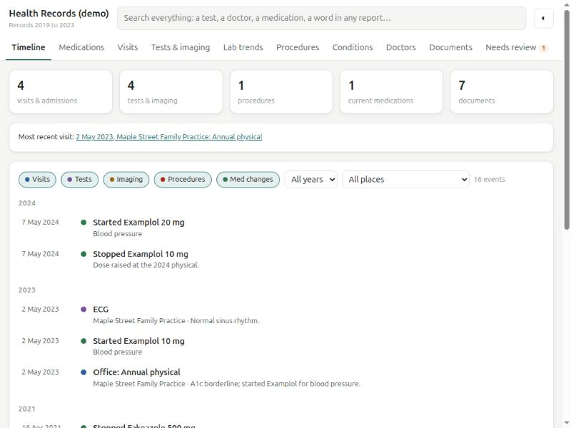

# healthdash

A private, self-hosted dashboard for one person's medical history: visits, tests, lab results,
procedures, and when each medication was started and stopped, with bills and statements kept on a
separate tab. Every line links back to the original PDF or scan it came from, and the full text of
every document is searchable.

Built for a family member whose records were a folder of hospital printouts, portal exports,
scanned letters and imaging CDs. It runs on a Raspberry Pi–class box on the home network.



## What it does

- **Timeline**: every visit, test, procedure and medication change in date order, filterable by type,
  place and year.
- **Medications**: current list plus a history chart of when each one started and stopped (one row
  per dose change).
- **Visits, Tests & imaging, Procedures, Conditions, Allergies, Doctors**: tables you can edit in place.
- **Lab trends**: every analyte charted over time against its reference range, values from
  different labs normalized to one name.
- **Documents**: every source file with date, kind and facility; opens the original. OCR'd text is
  searchable (SQLite FTS5).
- **Add records**: drop PDFs or phone photos onto the page. Each one is read (OCR for scans),
  sorted by kind, date and facility, its lab values and bill amount are pulled out, and it is
  filed. Anything it isn't sure about is put to you as a question, with its best guess filled in.
  It learns facilities from what's already filed. All of it runs on the server, nothing leaves it.
- **Needs review**: uploads with open questions, new files the catalog doesn't know yet.
- **Financial**: what was billed or quoted, by whom and for what, apart from the health tabs.
  Quotes are kept apart from bills; whether anything was paid is deliberately not tracked.

## Privacy design

Medical records are about as sensitive as data gets, so:

- Python 3 standard library + SQLite only. No dependencies, no CDN, no outside API or lookup.
- Text extraction and OCR (`pdftotext`, `tesseract`) run locally on the machine that holds the files.
- The dashboard listens on the LAN. Only the configured ingest machine may import or upload.
- Request logging is off, so search terms don't end up in the system journal.
- The systemd unit runs as its own user with `ProtectSystem=strict`, `ProtectHome`, `UMask=0077`.
- Nothing personal lives in the code: names, facilities and paths go in `data/local.json` and
  `deploy/local.env`, both git-ignored along with every PDF, scan, text cache and database.

## Check an install

```bash
python3 -m healthdash check            # on the server: Python, SQLite FTS5, PDF + OCR tools
python3 -m healthdash check --ingest   # on the machine with the records folder
```

It lists anything missing and the command that installs it. The dashboard itself also shows a
warning on **Add records** when the server can't read files yet; files added meanwhile are kept
and read automatically once the tools are installed.

## Try it

```bash
python3 -m healthdash demo            # made-up sample data, http://127.0.0.1:9380
python3 -m unittest                   # tests (sample data only)
```

## Using it for real

The server needs `poppler-utils` and `tesseract-ocr` for **Add records** to read files.

On the machine that has the records (needs `poppler-utils`, `tesseract-ocr`, and LibreOffice for `.doc`):

1. `cp sample/local.example.json data/local.json` and set `source` to the folder of records.
2. `python3 -m healthdash ingest --dry-run` extracts text (cached in `extracted/`) and lists what it found.
3. Describe files in `data/catalog.json` (title, date, category, facility) and put structured
   history in `data/records.json`; the format is the same as `sample/records.json`. Anything not in
   the catalog still shows up, flagged "needs review", and everything can be edited on the dashboard.
4. `python3 -m healthdash organize` previews a sorted, consistently named copy of the records
   (hard links, originals untouched); add `--apply` to create it.

On the server:

1. `cp deploy/local.env.example deploy/local.env` and fill in the server login, URL and ingest IP.
2. `deploy/install.sh` once (asks for sudo on the server), then `deploy/sync.sh push` for code
   changes, `deploy/sync.sh ingest` for new records, `deploy/sync.sh backup` for a database copy.

Edits made on the dashboard are kept: re-importing never overwrites a record someone changed by hand.

## Layout

```
healthdash/
  extract.py    PDF text + OCR, DICOMDIR headers from imaging discs, cached by sha256
  catalog.py    per-file metadata; guesses dates/titles for new files
  parsers.py    lab printout parsers (portal lists, Cerner-style result blocks) + analyte names
  organize.py   sorted, renamed hard-link copy of the source folder
  ingest.py     extract -> describe -> POST to the dashboard -> upload missing files
  classify.py   what an uploaded document is (kind, date, facility, title, amount) + questions
  uploads.py    files added on the dashboard: save, read in the background, file or ask
  store.py      SQLite schema, FTS search, timeline, lab series, edit tracking
  server.py     JSON API + static page
  static/index.html   the whole UI, no build step
deploy/         install.sh, sync.sh, systemd unit
sample/         made-up demo data and an example local.json
```
