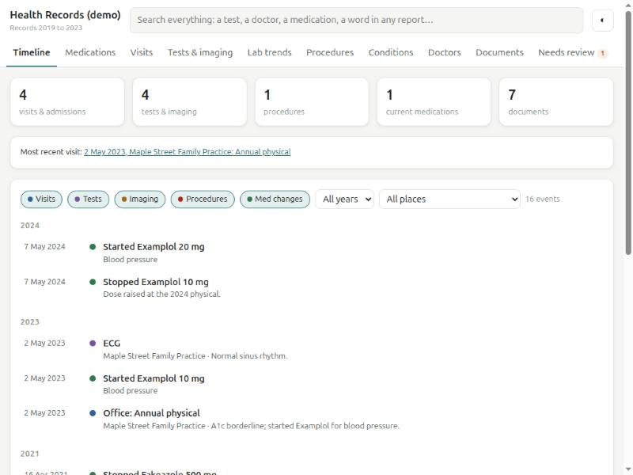
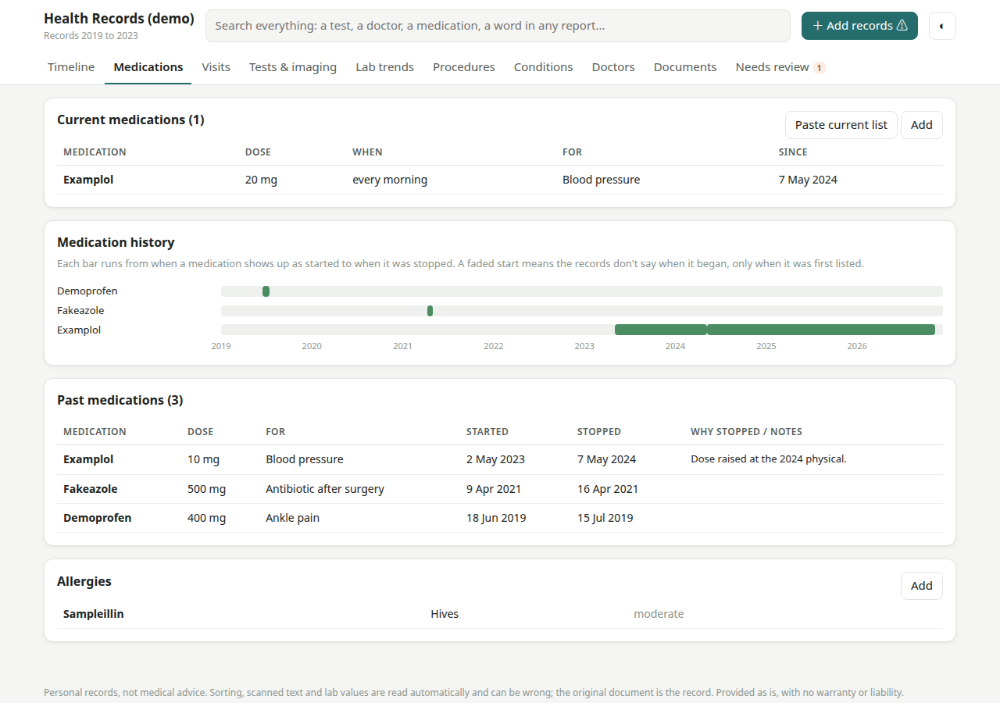
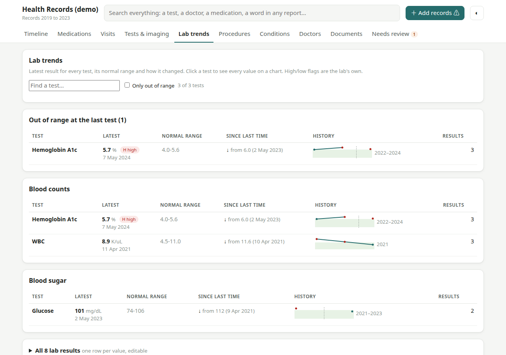
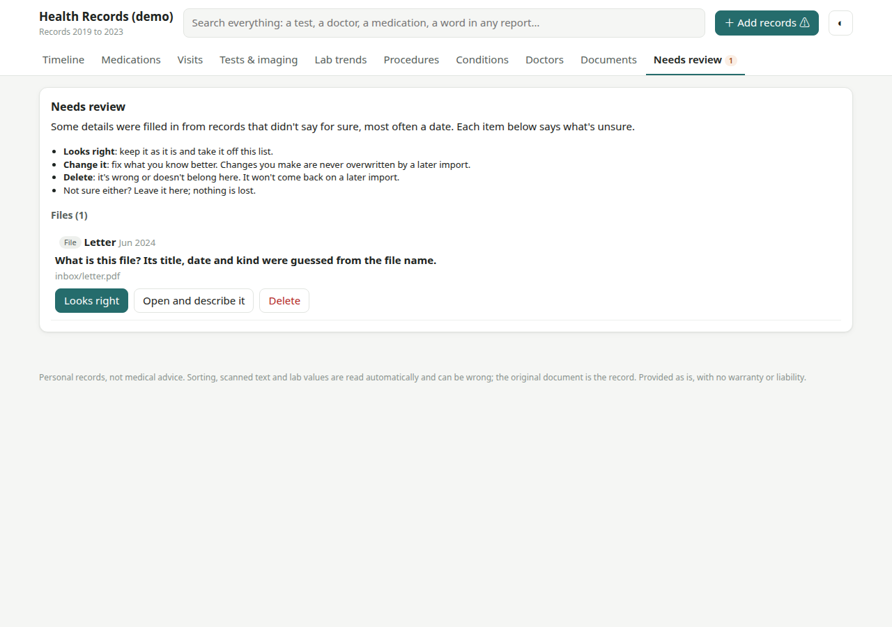

<p align="left">
  <picture>
    <source media="(prefers-color-scheme: dark)" srcset="assets/brand/zs-logo-horizontal-dark-bg.svg">
    
  </picture>
</p>

# healthdash

Self-hosted personal health record dashboard. Import MyChart and other patient portal exports,
search medical PDFs and scans with local OCR, and track doctor visits, lab trends, and medication
history. Runs on Linux, Raspberry Pi, and macOS.

One person's medical history in one place: visits, tests, lab results, procedures, doctors, and
when each medication was started and stopped. Every line links back to the original PDF or scan it
came from, and the full text of every document is searchable. Python standard library and SQLite,
no other dependencies.

Built for a family member whose records were a folder of hospital printouts, portal exports,
scanned letters and imaging CDs. It runs on a small Linux box (a Raspberry Pi–class computer) or a
Mac on the home network.

> **Not medical advice. No warranty. Use at your own risk.** This is a personal record-keeping
> tool, not a medical device. It can misread, mis-sort or miss information. Always check the
> original documents and ask a doctor. See [Disclaimer](#disclaimer).



## What it does

- **Timeline**: every visit, test, procedure and medication change in date order, filterable by type,
  place and year.
- **Life events**: add things outside medical care that may bear on health (a car accident, a fall,
  a death or illness in the family, a move, a stressful stretch) with when it happened and how it may
  affect health. They show on the Timeline, on their own tab and in the printed summary.
- **Medical codes**: conditions and procedures carry their codes (ICD-10, ICD-9, SNOMED CT, CPT,
  HCPCS, ICD-10-PCS) and medications their RxNorm code, read from health summary exports or typed in (a code on its own is enough; its
  system is worked out and its shape checked). Search finds an entry by its code. No code lists are
  shipped or looked up online, so the dashboard shows codes but not their official descriptions.
- **Printable summary**: **🖨 Summary** makes one page of what is going on and when: current
  conditions with codes, allergies, current medicines, surgeries, life events, out-of-range lab
  results, a dated history and past conditions and medicines. Pick the dates and sections, then
  print it, download it as a **PDF**, or download it as a web page that opens in any browser.
  **🖨 Print list** on the Medications tab (also in the Summary dialog) prints just the allergies and
  the medicines taken now, in large type with blank rows for changes: for a wallet, the fridge or a
  new doctor's forms. It also comes as a PDF.
- **Emergency card**: in the Summary dialog, one page (two at most) for paramedics, the ER or a
  caregiver: emergency contacts, date of birth and blood type, allergies (severe ones in red),
  prescription medicines, the conditions you choose, implants and devices, recent surgeries, doctor,
  pharmacy, insurance and anything else to know first. **Edit details** holds what no medical
  record says; the rest comes from the records. Print it or download it as a PDF to keep on a phone.
- **Questions for the next visit**: the **Questions** tab. Write a question down when it comes up,
  optionally with who to ask (a doctor, a clinic or a kind of doctor) and marked important. **Print the
  list** to take along, grouped by doctor with room to write the answers (or one doctor's questions
  on their own, or a PDF). Afterwards, **Answered…** notes what was said and at which visit; the
  visit then shows the questions answered there, and search finds them.
- **Home readings**: the **Home readings** tab. Log blood pressure (with pulse), weight, blood sugar,
  temperature, oxygen, peak flow, pain or anything else, with the time and a note. Or paste a list
  from a notebook or a meter's or app's CSV export, check what was read, and save it; readings already
  there aren't added twice. Each kind gets its latest value, a 30-day average and a chart (30 days to
  all years). **Print** gives a doctor the averages (mornings against evenings for blood pressure)
  and every reading, as a page or a PDF. Readings outside common general ranges show in red; these
  aren't anyone's personal targets.
- **Medications**: current list plus a history chart of when each one started and stopped (one row
  per period of use). Paste the current list from a doctor or pharmacy and the dashboard shows what
  it would change (started, stopped, a dose that differs, one drug under two names) before saving
  anything; misspellings are matched. Over-the-counter medicines and supplies are listed on their
  own, without start and stop dates.
- **Visits, Tests & imaging, Procedures, Conditions, Allergies, Doctors**: tables you can edit in place.
  The same doctor written different ways ("Pat Q. Example MD", "Dr. Pat Example (cardiology)") is one
  entry; a place written different ways ("EXAMPLE GEN HOSP", "Example General Hospital") gets one
  name, from a list of other spellings you keep in `data/local.json` (`place_names`); and a
  procedure that a portal export and an operative report both list is one entry.
- **Lab trends**: the latest result of every test with its normal range and the change since last
  time, out-of-range results first, grouped by kind (blood counts, kidney, liver, sugar...). Click a
  test for a chart of every value, one hospital stay at a time or all years.
- **Sign-in (optional)**: off on a new dashboard, so anyone on your network can open it. Turn it on
  under **👤 Accounts**, which makes the first account at the same time; after that, anyone signed in
  can add or remove accounts, reset passwords, or turn sign-in off again. All accounts are equal.
  Forgot every password? On the server, `python3 -m healthdash login off --db <database>` or
  `python3 -m healthdash user passwd NAME --db <database>`.
- **Documents**: every source file with date, kind and facility; opens the original. OCR'd text is
  searchable (SQLite FTS5).
- **Add records**: drop PDFs or phone photos onto the page, pick many files or a whole folder
  (subfolders too), or add a zip of records. Files it can't read are skipped and listed, and one card
  shows the progress of a large batch. Each one is read (OCR for scans),
  sorted by kind, date and facility, its lab values are pulled out, and it is
  filed. Anything it isn't sure about is put to you as a question, with its best guess filled in.
  Copies of documents already filed are caught and lab values are never added twice.
- **Photos of a paper record**: under **Add records** on a phone or tablet, take a photo of each page
  (or pick photos). Pages can be removed before sending; they go in as one PDF, made in the browser
  (turned upright and shrunk to a readable size first), and are read like any scan.
- **On a phone**: the header shrinks to the essentials, the tabs scroll sideways, tables become one
  card per entry (each value under its column's name), dialogs fill the screen, and text fields are
  large enough that the phone doesn't zoom in.
- **Needs review**: uploads with open questions, new files the catalog doesn't know yet, and
  entries filled in from records that didn't say for sure. Each says in plain words what to check
  (usually a date), and "See the source" opens the original at the right pages.

Everything runs on your own machine. Nothing is sent to any outside service, API or cloud.

| Medications | Lab trends | Needs review |
|---|---|---|
|  |  |  |

All screenshots use the made-up demo data (`python3 -m healthdash demo`). `docs/social-preview.png` is the
image GitHub shows when the repository link is shared.

## What it does not do

- **It does not give medical advice** or interpret results. It shows what the documents say; the
  "H"/"L" flags are copied from the lab's own reference ranges. It is not a medical device and has
  not been reviewed or approved by any regulator.
- **It is not always right.** Sorting uploads, reading scans (OCR) and pulling out lab values are
  automatic and make mistakes: wrong dates, wrong kind, misread numbers, missed values. It asks
  when it's unsure, but it can be wrong without asking. The original document is the record.
- **Its sign-in is simple, not internet-grade.** There are a few accounts, all with the same access:
  anyone with an account can see and change everything and manage the other accounts. There are no
  roles, no two-factor codes, and the dashboard speaks plain HTTP, so passwords cross your local
  network unencrypted. It keeps casual visitors on a home network out. Do not expose it to the
  internet.
- **It does not encrypt** the database or the stored files. Protect the machine it runs on (disk
  encryption, a user account others can't use).
- **It is not a backup.** `deploy/sync.sh backup` copies the database and uploaded files to another
  machine, but keeping your original documents safe is up to you.
- **It is not built for clinics or businesses** and makes no claim of HIPAA or any other
  compliance. It is meant for a person or a family keeping their own records.
- **It does not keep bills or costs.** Bills and statements are kept as documents only; amounts,
  payments and estimates are not tracked.
- **It does not fetch records** from patient portals, insurers or pharmacies. You download them
  and add them.
- **It does not read imaging** (the CT/MRI pictures themselves). It lists the studies on a disc;
  open them with the disc's viewer.
- **Windows is not supported.** Linux (Debian, Ubuntu, Raspberry Pi OS) and macOS are.

## Privacy design

Medical records are about as sensitive as data gets, so:

- Python 3 standard library + SQLite only. No dependencies, no CDN, no outside API or lookup.
- Text extraction and OCR (`pdftotext`, `tesseract`) run locally.
- Sign-in is optional; when it's on, everything needs a signed-in account. Passwords are stored as
  salted PBKDF2 hashes; sessions use an HttpOnly, SameSite=Strict cookie; repeated wrong passwords
  are slowed down. Either way, changes are only accepted from the dashboard's own page, and the
  dashboard only answers when opened by an address or a local name, so a website can't reach it
  through its own domain (DNS rebinding). If it's opened by a real domain name on your network,
  add `--allow-host that.name` to `serve`.
- Security review: [docs/SECURITY.md](docs/SECURITY.md).
- Without an account, only the configured ingest machine can bulk-import records or download
  backups, and the same computer can only send records in, not read them.
- Request logging is off, so search terms don't end up in system logs.
- On Linux the service runs as its own user with `ProtectSystem=strict`, `ProtectHome`, `UMask=0077`.
- Nothing personal lives in the code: names, facilities and paths go in `data/local.json` and
  `deploy/local.env`, both git-ignored along with every PDF, scan, text cache and database.

## Try it

```bash
python3 -m healthdash demo            # made-up sample data, http://127.0.0.1:9380
python3 -m unittest                   # tests (sample data only)
```

## Check an install

```bash
python3 -m healthdash check            # Python, SQLite FTS5, PDF + OCR tools
python3 -m healthdash check --ingest   # the machine with the records folder (adds LibreOffice)
```

It lists anything missing and the command that installs it on your system. The dashboard also
shows a warning on **Add records** when it can't read files yet; files added meanwhile are kept
and read automatically once the tools are installed.

## Install on a Mac

Everything (the dashboard and reading the records) runs on the one Mac.

```bash
brew install poppler tesseract         # https://brew.sh ; LibreOffice is optional, for old .doc files
python3 -m healthdash check
python3 -m healthdash service install  # starts at login; http://127.0.0.1:9380
```

Run these in this folder (where the code was downloaded or cloned). The `python3` that comes with
the Mac (macOS offers to install the command line tools the first time) is new enough: any Python
3.8 or newer works, as do Homebrew's and python.org's. Safari, Chrome and Firefox all work.

- `service install --lan` lets other devices on your network open it: turn on sign-in first (see the login warning above).
  `--port` and `--title` change the port and the name shown on the page.
- Data lives in `~/Library/Application Support/healthdash`, the log in `~/Library/Logs/healthdash.log`.
- `python3 -m healthdash service status` and `service uninstall` (your data is kept).
- The service runs the code from this folder, so after `git pull` run `service install` again to restart it.

## Install on Linux (a Raspberry Pi or other server)

The server needs `poppler-utils` and `tesseract-ocr` (`deploy/install.sh` installs them).

On the machine that has the records (needs the same, plus LibreOffice for `.doc`):

1. `cp sample/local.example.json data/local.json` and set `source` to the folder of records.
2. `python3 -m healthdash ingest --dry-run` extracts text (cached in `extracted/`) and lists what it found.
3. Describe files in `data/catalog.json` (title, date, category, facility) and put structured
   history in `data/records.json`; the format is the same as `sample/records.json`. Anything not in
   the catalog still shows up, flagged "needs review", and everything can be edited on the dashboard.
4. `python3 -m healthdash organize` previews a sorted, consistently named copy of the records
   (hard links, originals untouched); add `--apply` to create it.

On the server:

1. `cp deploy/local.env.example deploy/local.env` and fill in the server login, URL and ingest IP.
2. `deploy/install.sh` once (asks for sudo on the server), then `deploy/sync.sh push` for code
   changes, `deploy/sync.sh ingest` for new records, `deploy/sync.sh backup` for a database copy.
3. Sign-in starts off. To require it, open **👤 Accounts** and turn it on (it makes the first
   account), or on the server run `python3 -m healthdash user add NAME --db <database>` then
   `python3 -m healthdash login on --db <database>`.

Edits made on the dashboard are kept: re-importing never overwrites a record someone changed by hand.

## More people

**From the web page (the easy way):** pick **＋ Add family member…** in the people menu at the top
(next to the title), type their name, and the dashboard switches to their records. Each person's
records and files are kept apart; switch between people with the same menu. Rename people under
**👤 Accounts → People**. Everyone who can use the dashboard sees every person on it, and
backups (`deploy/sync.sh backup`) include them all.

**A separate dashboard** (own address, own accounts) is for someone whose records others in the
house shouldn't see. Each gets its own port and backups, all on the same server and sharing the
same program code.

```bash
deploy/add-person.sh alex 9381 "Alex's Health"   # asks for the server's sudo password once
```

It creates the service `healthdash-alex` with its data in `/var/lib/healthdash-alex` and adds it to
`OTHERS` in `deploy/local.env`, so `deploy/sync.sh push` updates and restarts it and
`deploy/sync.sh backup` copies it into `backups/alex/`. Open `http://<server>:9381` and create its first
account right away.

## Where records are kept

The dashboard keeps its own copy of every original file (PDFs, scans, health summaries) in its data
folder. To keep them somewhere else, such as a bigger disk, a USB drive or a shared folder, open
**👤 Accounts → Where records are kept**, type a folder on the server, and press **Move records here**.
Everyone's files move there (checked as they're copied to another disk), and a readable copy is kept
beside them, sorted by person and kind of record:

```
Records/
  Sam/04 Labs/2024-03-05_Riverside-Clinic_Lipid-panel.pdf
  Alex/02 Office visits and consults/2023-11-02_Lakeside-Family-Medicine_Office-visit.pdf
  .healthdash-store/      the dashboard's own copy (leave this alone)
```

The readable copy follows renames, new files and deletions within a few seconds. Its files are
linked to the originals, so they take no extra space (on drives that can't link files, such as some
USB and network drives, they are copies). They are read-only: copy one out to mark it up. Anything
you put in the folder yourself is left alone. **Back to the data folder** moves everything back.

On a Linux server the service may only write to its own data folder. Allow the new one first:

```bash
sudo systemctl edit healthdash     # add the two lines:  [Service]  and  ReadWritePaths=/mnt/records
sudo chown healthdash /mnt/records
sudo systemctl restart healthdash
```

If the folder's drive isn't connected, the dashboard says so and files can't be opened or added
until it is. The database itself stays in the data folder; `deploy/sync.sh backup` still copies
everything.

## Getting everything out of a patient portal

Several portals can export every visit at once. Drop the file they give you on the dashboard
(**Add records**); it reads the health summaries inside, skips anything it already has, and files the rest.

- **MyChart** (Epic): open `/MyChart/app/requested-records` on your MyChart site and request all
  visits. The download is a `HealthSummary_*.zip`.
- **FollowMyHealth**: open the **My Health** menu, choose **Send**, then export. The download is a zip
  (`AllPatientData.zip`).
- **IQHealth / HealtheLife** (Oracle Health, formerly Cerner): on `iqhealth.com`, open your health
  record's sharing page, `/person/<your id>/health-record/sharing/`, and download the health summary.

## Layout

How the parts fit together, the data model, the import rules and the API are in
[docs/SYSTEM.md](docs/SYSTEM.md).

```
healthdash/
  extract.py    PDF text + OCR, DICOMDIR headers from imaging discs, cached by sha256
  catalog.py    per-file metadata; guesses dates/titles for new files
  parsers.py    lab printout parsers (portal lists, Cerner-style blocks, LabCorp reports) + one name per test
  ccda.py       health summary exports (C-CDA): visits, results, medications, problems, vaccines, pages
  fhir.py       FHIR bundle exports into the same shapes
  organize.py   sorted, renamed hard-link copy of the source folder
  ingest.py     extract -> describe -> POST to the dashboard -> upload missing files
  codes.py      medical codes (ICD-10, SNOMED CT, CPT, ...): read, checked, written one way
  report.py     the printouts: health summary, medicines and allergies (HTML or PDF)
  emergency.py  the emergency card and its details (contacts, blood type, devices, ...)
  questions.py  questions for the next visit: grouping and the list to take along
  readings.py   home readings: types and ranges, pasted lists, the log for a doctor
  pdf.py        a small PDF writer for them (standard library only)
  classify.py   what an uploaded document is (kind, date, facility, title, amount) + questions
  uploads.py    files added on the dashboard: save, read in the background, file or ask; one-time passes
  checks.py     record checks: questions on the Review tab about likely mistakes and duplicates
  people.py     several people on one dashboard
  storage.py    where the original files are kept, and the readable sorted copy
  doctor.py     `check`: what's installed and how to install what isn't
  auth.py       optional sign-in: accounts, password hashing, sessions
  macos.py      `service`: launchd setup on a Mac
  store.py      SQLite schema, FTS search, timeline, lab series, edit tracking, tidy-up passes
  server.py     JSON API + static page
  static/index.html   the whole UI, no build step
deploy/         Linux server: install.sh, sync.sh, add-person.sh, systemd unit
docs/           SYSTEM.md (how it works), SECURITY.md (security review) and screenshots
sample/         made-up demo data and an example local.json
```

## Disclaimer

This software is provided **as is**, without warranty of any kind, express or implied, including
fitness for a particular purpose, accuracy, or that it will keep your data safe or private. The
author is **not liable** for any damages or losses of any kind arising from using it or being unable
to use it, including medical decisions, missed or wrong information, data loss, or disclosure of
personal or health information. It is not medical, legal or financial advice. You are responsible
for checking everything it shows against the original documents and for protecting your own
records. The [License](LICENSE) has the full warranty disclaimer and limitation of liability, which
apply as far as the law allows.

## License

MIT, see [LICENSE](LICENSE). The ZS Tech mark files in `assets/brand/` are not covered by the MIT
License: they are all rights reserved and may be used only to identify ZS Tech (Zachary Spalding Technology Services) and its projects.

---

 A **ZS Tech** project · Zachary Spalding Technology Services · [zspalding12083](https://github.com/zspalding12083). Systems · Networks · Cloud · Open source.
